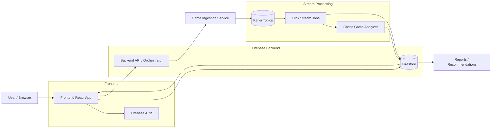

# Chess Trainer

Chess Trainer is a chess profiling and training pipeline that ingests public game histories, analyzes them, and generates targeted training material.

## Architecture Overview

## What the diagram shows

- The frontend is a React application that handles user interaction and authentication.
- Firebase provides the backend identity and persistent data layer through Auth and Firestore.
- Game ingestion publishes chess games into Kafka topics.
- Flink consumes those topics, coordinates stream processing, and passes the games to the analyser.
- The analyser writes structured results back to Firestore for the frontend to display.

## Related documentation

- See [`ARCHITECTURE.md`](ARCHITECTURE.md) for the full system workflow and service breakdown.
